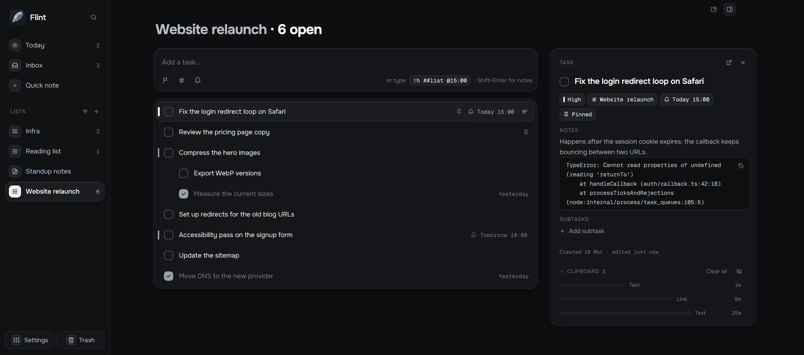

<p align="center"></p>

<h1 align="center">Flint</h1>

A fast, keyboard-first place for the tasks and notes that pop up while you work. Built for developers on Windows.

## Why Flint exists

I built Flint for myself. I wanted one app that does both a real task list (like Microsoft To Do) and a real markdown editor for notes, and that fits the way I work as a developer: capturing things mid-call without breaking focus, pasting code and stack traces, linking work items, sharing my screen without leaking anything, and never losing data. Every feature and design choice here is what turned out most comfortable and efficient for me in daily use. If you work the same way, it might suit you too.

> **How this was made:** Flint was written entirely by [Claude Code](https://claude.com/claude-code), Anthropic's AI coding agent. I designed it, made the decisions, and tested every build by hand on my own machine, sending feedback round after round. The design docs and the full decision log are in [`docs/`](docs/).



## What makes it different

- **Capture from anywhere.** `Ctrl+Shift+Space` opens a tiny popup over any app; type and press Enter. `Ctrl+Shift+X` captures the text you've selected, in a browser, Teams or a terminal.
- **Shorthand while you type.** `!h` sets priority, `@15:00` a reminder, `##work` a list, shown live as chips.
- **Made for code.** Paste JSON, a stack trace or code and it becomes a code block with quiet grayscale highlighting. Screenshots paste straight in.
- **Mini mode for calls.** `Ctrl+Alt+Space` opens a small always-on-top window with Today, any task list (Inbox by default) and a note; `Ctrl+Alt+X` sends the text you've selected in any app to that note. It's left out of screen shares, and so is the capture popup.
- **Your clipboard history, beside your tasks.** Windows' clipboard history (Win+V) in the side panel, one click to insert into whatever you're typing in Flint. Its contents stay hidden until you hover, so screen shares don't leak what you copied.
- **Short links you define by example.** Paste one link and type how it should look (`AB#1234`, `PROJ-42`); Flint works out the pattern and links it everywhere, both ways.
- **Plain markdown files.** Every list and note is a `.md` file in a folder you choose, readable in Obsidian (Dataview-compatible fields) or any editor. No account, no lock-in.
- **Sync through your own Google Drive.** Keep chosen lists, notes and groups in step across your PCs (or everything): plain `.md` files in a Flint folder in your Drive, merged task by task, and where two PCs changed the same lines of a note both versions are kept for you to pick. There's no Flint server, and Flint can only see the files it created.
- **Today, pins and real reminders.** Pin tasks from any list into Today; reminders arrive as Windows notifications, also during Do Not Disturb (with Windows' default settings).
- **Inbox triage.** Sort a pile of captures one task at a time with single keys.
- **Hard to lose anything.** Automatic snapshots with a task-by-task compare and restore, plus a 30-day Trash.
- **Keyboard everywhere.** `Ctrl+K` finds any list, task or command; `?` shows every shortcut.

## Install

Download the latest `Flint-Setup-x.y.z.exe` from [Releases](https://github.com/DavitKhachaturovi/flint/releases) (Windows 11 x64; Windows 10 should work but isn't tested). It installs for you only, with no admin rights. The installer isn't code-signed yet, so Windows SmartScreen will warn you: choose **More info → Run anyway**. Flint updates itself from GitHub Releases afterwards (you can turn that off in Settings → About).

## Privacy

Your notes stay on your PC unless you turn on Google Drive sync, and then only what you choose goes to your own Google Drive; Flint has no server of its own. Flint sends no telemetry, and otherwise only contacts GitHub to check for updates, which you can turn off. The full policy: [flintnotes.app/privacy](https://flintnotes.app/privacy/).

## Development

Windows x64 and **Node.js 24.22.1 or newer on the 24.x line** (the version is in `.node-version`; npm 11 comes with it). Installs refuse other Node versions and any package published less than 7 days ago (`.npmrc`).

```sh
npm ci                                       # dependencies, exactly as locked
npm run install-electron -w @flint/desktop   # Electron's binary (npm ci doesn't run its install script)
npm run dev                                  # Flint in development (its own identity; never updates)

npm test                                     # unit tests (Vitest)
npm run typecheck
npm run lint
npm run format:check
npm run e2e                                  # build, then the Electron end-to-end tests (Playwright)

npm run dist -w @flint/desktop               # the installer: apps/desktop/dist-installer/Flint-Setup-<version>.exe
```

The end-to-end tests keep their windows off-screen and never touch your clipboard; the capture popup's tests bring it to the front for a moment, as the hotkey does, so avoid typing while they run. `docs/` is the spec (start with [`docs/README.md`](docs/README.md)); [`CLAUDE.md`](CLAUDE.md) has the working rules. Releases are built by GitHub Actions from a `v*` tag.

## License

MIT © 2026 Davit Khachaturovi (see [LICENSE](LICENSE)). Bundled fonts (Onest, FiraGO, Geist Mono) are under the SIL Open Font License.
